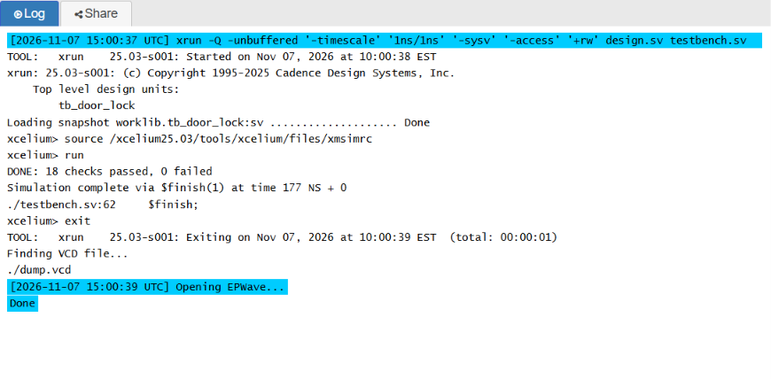
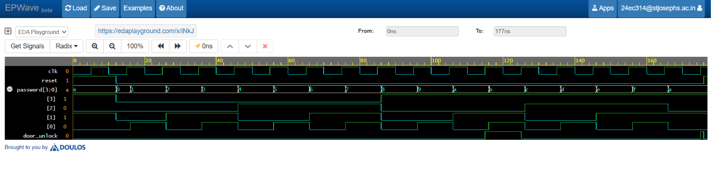

# Digital Password-Based Door Lock (Verilog HDL)

Verilog RTL design of a door lock that unlocks when a 4-bit password matches the stored one, with a self-checking testbench and simulation waveforms.

## How it works

The stored password is `1010`. On every rising clock edge the input `password[3:0]` is compared with it. A match sets `door_unlock` to 1 and anything else sets it to 0. `reset` is asynchronous and forces the door locked immediately. The output is registered, so it changes one clock edge after the password changes.

## Signals

| Signal | Direction | Description |
|---|---|---|
| `clk` | Input | Clock |
| `reset` | Input | Asynchronous reset, locks the door |
| `password[3:0]` | Input | 4-bit password entered by the user |
| `door_unlock` | Output | 1 = unlocked, 0 = locked |

## Run it on EDA Playground

Open the [saved playground](https://edaplayground.com/x/iNkJ), titled "Digital password-Base Door lock system", or copy in the [design](rtl/door_lock.v) and [testbench](tb/tb_door_lock.v), with `tb_door_lock` as top. In Tools & Simulators pick Cadence Xcelium 25.03, using the SystemVerilog design/testbench editors. Set Compile Options to `-timescale 1ns/1ns -sysv` and Run Options to `-access +rw`. Tick Open EPWave after run, then click Run.

In EPWave, click Get Signals, open `tb_door_lock`, and pick `clk`, `reset`, `password` and `door_unlock`. `$dumpfile("dump.vcd")` and `$dumpvars` are already set in the testbench.

## Verification

The testbench is self-checking and prints a pass/fail summary. It runs three tests:

1. Reset holds the door locked even when `1010` is applied.
2. All 16 possible passwords (`0000` to `1111`) are applied one at a time. Only `1010` may unlock the door.
3. Reset while the door is unlocked locks it immediately, without waiting for a clock edge.

The run on 7 November 2026 passed 18 checks (1 + 16 + 1) with 0 failures. See the [Xcelium log](sim/xrun-20261107.log).



## Results

When the sweep reaches `1010`, `door_unlock` goes high on the next rising clock edge. It goes low again on the clock edge after the password changes to `1011`. The final test applies `1010`, then raises `reset` and the output drops straight to 0.



*The waveform timeline is in ns.*

## Folder structure

```
door-lock-verilog/
├── images/        waveform and simulation output screenshots
├── rtl/           design source (door_lock.v)
├── sim/           Xcelium simulation log
├── tb/            testbench (tb_door_lock.v)
├── .gitignore
└── README.md
```

## Tools used

- Language: Verilog HDL
- Simulator: Cadence Xcelium 25.03 on EDA Playground
- Waveform viewer: EPWave

## Limitations and future work

- The password is fixed in the code.
- There is no `enter` input, so the password is checked on every clock edge.
- There is no wrong-password output, attempt limit or alarm.

Planned next: `enter` and `lock` inputs, a `wrong_password` output, a three-attempt limit with alarm, automatic relocking, password change mode, and FPGA implementation.